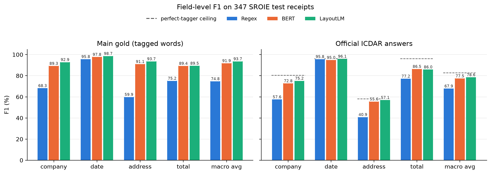

# Receipt / Invoice Information Extraction with Layout-Aware Transformers

**Type:** Multimodal (Image + Text) · Deep Learning course project

**Report:** [`report/report.pdf`](report/report.pdf) (LaTeX source in [`report/`](report/), Computer Vision / ELCVIA template)

## Team

| Name | Roll number | GitHub | Main work |
|---|---|---|---|
| Himanshu Kanwar Chundawat | 202410101200056 | [@chundawat-h](https://github.com/chundawat-h) | Repo setup, evaluation script, regex baseline, results analysis, report (intro, related work, regex, results, conclusion) |
| Hiranya Patil | 202410101200058 | [@hiranya25](https://github.com/hiranya25) | Data exploration, BERT, LayoutLM, report (dataset, BERT, LayoutLM, experimental setup) |

## Problem Statement

Extract key fields (**company**, **date**, **address**, **total**) from scanned receipts using text and layout.

## Research Question

How much does layout information add over text alone? We answer this with a field-wise F1 comparison of three methods.

## Dataset

**SROIE** (ICDAR 2019 Robust Reading Challenge on Scanned Receipts OCR and Information Extraction) [2]. We use two Hugging Face versions of the same receipts together:

| Version | Contents | Used for |
|---|---|---|
| [`darentang/sroie`](https://huggingface.co/datasets/darentang/sroie) | OCR words, word boxes (already scaled to 0–1000), one BIO tag per word | Training BERT / LayoutLM, regex input, main evaluation gold |
| [`jsdnrs/ICDAR2019-SROIE`](https://huggingface.co/datasets/jsdnrs/ICDAR2019-SROIE) | Receipt images, official ICDAR answers (company, date, address, total) | Figures, second evaluation against the official answers |

The two are matched on the receipt **key**, which is the image file name (e.g. `X51005230621`). `src/data.py` loads the tagged data (`load_sroie()`) and images (`load_images()`).

- **Train:** 626 receipts. **Test:** 347 receipts with word tags. `jsdnrs` has 14 extra test receipts without word tags, which we leave out.
- About 117 words per receipt on average. 84.7 % of words are `O` (not a field).
- Details and figures: `notebooks/01_data_exploration.ipynb`.

## Approach

| # | Method | Input | Notebook |
|---|--------|-------|----------|
| 1 | OCR + Regex baseline | Text (hand-written rules) | `notebooks/02_regex_baseline.ipynb` |
| 2 | BERT token classification | Text only | `notebooks/03_bert_text_only.ipynb` |
| 3 | LayoutLM | Text + 2D position | `notebooks/04_layoutlm.ipynb` |

All methods are scored with the same field-level evaluation (`src/evaluate.py`): exact match after normalisation, with precision, recall and F1 per field, on the 347 test receipts. We report two scores:

1. **Main:** against the gold string built from the tagged words. This measures whether a method picks the right words.
2. **Second:** against the official ICDAR answers. OCR misreads cap this score: even perfect tagging reaches only 82.8 % macro exact match (address 58.2 %). See `results/oracle_ceiling_vs_official.csv`.

## Results

Field-level F1 (%) on the 347 test receipts (`notebooks/05_results_analysis.ipynb`, `results/final_results*.csv`).

**Main score** (gold built from the tagged words):

| Field | Regex | BERT | LayoutLM | Layout gain (LayoutLM − BERT) | 95 % CI of gain |
|---|---|---|---|---|---|
| company | 68.3 | 89.3 | **92.9** | **+3.6** | [0.9, 6.5] |
| date | 95.8 | 97.8 | **98.7** | +0.9 | [0.0, 2.0] |
| address | 59.9 | 91.1 | **93.7** | **+2.6** | [0.9, 4.6] |
| total | 75.2 | 89.4 | **89.5** | +0.1 | [−3.1, 3.6] |
| **macro avg** | 74.8 | 91.9 | **93.7** | **+1.8** | [0.5, 3.2] |

**Second score** (official ICDAR answers; ceiling = perfect word tagging, limited by OCR noise):

| Field | Regex | BERT | LayoutLM | Ceiling |
|---|---|---|---|---|
| company | 57.6 | 72.8 | **75.2** | 80.4 |
| date | 95.8 | 95.0 | **96.1** | 96.3 |
| address | 40.9 | 55.6 | **57.1** | 58.2 |
| total | 77.2 | **86.5** | 86.0 | 96.3 |
| **macro avg** | 67.9 | 77.5 | **78.6** | 82.8 |



**Answer to the research question:** with the same tokenizer, data and training, adding 2D word positions (LayoutLM) improves macro F1 by **about 2 points** over text-only BERT (91.9 → 93.7). The paired bootstrap 95 % CI is [0.5, 3.2], so the gain is not noise.
- **Company and address gain.** These are blocks of text, and layout lets LayoutLM see where each block starts and ends. BERT tends to add a neighbouring line or drop the first word.
- **Total doesn't gain.** The training tag sits on the "TOTAL" line in only about two thirds of receipts, so position is not a consistent signal.
- **Most of the jump over regex comes from text alone:** BERT is +17 points over regex.
- **Caveat:** each model was trained once (seed 42).

## Project Structure

```
notebooks/
  01_data_exploration.ipynb   # dataset stats and visualisation
  02_regex_baseline.ipynb     # Method 1
  03_bert_text_only.ipynb     # Method 2
  04_layoutlm.ipynb           # Method 3
  05_results_analysis.ipynb   # comparison and field-wise F1 analysis
src/
  data.py                     # shared dataset loading (tagged words + images)
  evaluate.py                 # shared field-level evaluation
  regex_baseline.py           # Method 1 rules
results/                      # predictions (*_preds.json), scores (*_scores*.csv),
                              # hyperparameters, training logs, figures, final_results*.csv
report/                       # report PDF + LaTeX source (main.tex, sections/, references.bib)
requirements.txt
```

No model weights are stored. BERT and LayoutLM train in about 2.5 minutes each on a Colab T4, and all predictions are saved in `results/`. Notebooks 02 and 05 run on CPU.

To score any prediction file from the command line:

```bash
python -m src.evaluate results/regex_preds.json results/bert_preds.json results/layoutlm_preds.json
```

## How to Run

1. Open the notebooks in Google Colab (Runtime → Change runtime type → T4 GPU for notebooks 03 and 04).
2. Install dependencies: `pip install -r requirements.txt` (each notebook's first cell does this in Colab).
3. Run the notebooks in order, 01 → 05. In Colab, the setup cell clones this repo so `src/` can be imported. To reproduce only the comparison, run notebook 05: it reads the saved predictions and needs no GPU.

## References

1. Xu et al., *LayoutLM: Pre-training of Text and Layout for Document Image Understanding*, KDD 2020. https://arxiv.org/abs/1912.13318
2. Huang et al., *ICDAR2019 Competition on Scanned Receipt OCR and Information Extraction*, ICDAR 2019. https://arxiv.org/abs/2103.10213
